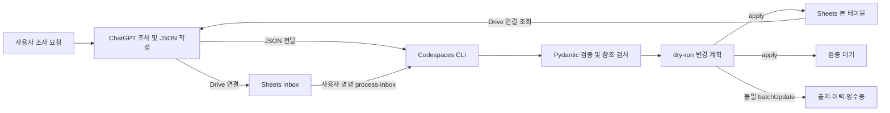

# 아키텍처 및 구현 계획

## 저장소 조사

2026-10-11 확인: 기존 파일은 내용이 거의 없는 README.md 하나입니다. Python 애플리케이션, 의존성, AGENTS.md가 없으며 개발 환경은 Python 3.14.2입니다. 기존 데이터 삭제나 마이그레이션은 필요하지 않습니다.

## 구조

원본은 하나의 네이티브 Google Sheets 파일입니다. Python은 명령 실행 시 원본을 읽습니다. 로컬 JSON은 입력·테스트·명시적 백업만 허용합니다. ChatGPT 연결과 Python 서비스 계정 인증은 독립적입니다. 자동 조사·상시 수집·서버·유료 DB는 범위 밖입니다.

## 스키마

헤더는 `schema.py`에서 생성합니다. 공통 컬럼과 종류별 컬럼을 펼쳐 저장하여 Drive에서 이름·주소·지역·출처를 직접 검색합니다. 배열과 복합 객체는 JSON 텍스트, 가격과 ID는 정밀도 보존을 위해 문자열로 기록합니다.

공통 컬럼: `id`, `kind`, `category`, `region_id`, `name`, `local_name`, `source_url`, `sources`(출처 ID 배열), `researched_on`, `last_verified_on`, `verification_status`, `created_at`, `updated_at`. 알 수 없는 현지명·최종 확인일은 null/빈 셀입니다. 생성·수정 시각은 UTC로 프로그램이 부여합니다.

| 탭 | 종류별 필드 및 관계 |
| --- | --- |
| regions | level(country/macro_region/administrative_area/city/neighborhood), parent_region_id, country_code(ISO 3166-1), aliases. region_id는 부모와 같으며 국가만 null 가능 |
| foods | food_type, ingredients, features, representative_region_ids→regions |
| restaurants | address, latitude, longitude, signature_food_ids→foods, signature_menus, price(amount/currency/basis) |
| experiences | experience_type(attraction/cafe/activity/shopping/nature), address, latitude, longitude, price |
| transport | transport_type(airport/train_station/subway_station/route), address, 좌표, origin_region_id/destination_region_id→regions, accessibility, price |
| budgets | budget_type(lodging/transport/food/trip_total), price, duration_days, people |
| ratings | target_id→일반 항목, taste_fit(1–5), visited, satisfaction(1–5), notes. 개인 평가 출처는 선택 |
| sources | id, url, title, publisher, accessed_on. URL 기준 결정적 ID, 항목과 N:M 연결 |
| verification_queue | id, request_id, item_index, reason, target_id, payload_json, errors_json, created_at. 오류 원문 보존; 자동 승인하지 않음 |
| change_history | id, request_id, entity_id, table, action, before_json, after_json, created_at. 1단계 create/queue 기록 |
| ingestion_runs | id(request_id), payload_hash, report_json, created_at. 멱등성 및 불확실한 API 응답 복구 |
| inbox | request_id, payload_json, submitted_at. ChatGPT가 사용자 요청으로 추가. 실행 여부는 ingestion_runs가 원본 |
| review_decisions | id, queue_id→verification_queue, decision(approve/reject), entity_id, reviewer, reason, request_id, created_at. 원문은 보존하고 한 대기 항목당 최종 결정 하나 |
| field_sources | id, entity_id, entity_revision, field, source_ids→sources, basis(sources/personal), verified_on, request_id, created_at. 정확한 항목 버전별 필드 출처; 이전 버전도 보존 |

운영 레코드는 여행 항목이 아니므로 지역/현지명을 강제하지 않습니다. 모든 레코드에는 고유 ID가 있습니다. 통화 코드는 ISO 4217이며 가격이 없으면 price=null입니다. 예산도 근거 없이 임의 생성하지 않습니다.

## 입력과 저장 안전성

Pydantic discriminated union으로 종류별 필드를 검증하고 미정의 필드는 거부합니다. JSON 1.0은 기존 계약을 그대로 사용합니다. JSON 1.1은 입력 전용 모델로 검사하고 분류 사전/등록된 지역 별칭으로 정규화한 뒤 동일한 엄격한 여행 항목 모델로 재검증합니다. 3단계 저장 스키마 1.1은 운영 탭 두 개만 추가하며 기존 헤더와 ID 규칙은 유지합니다. 요청 봉투가 잘못되면 전체 거부하고 항목별 오류는 대기열로 보냅니다. 지역은 상위→하위 순으로 처리하며 외래키·계층·국가 코드 일치를 검사합니다.

기존 ID와 자연 식별키를 검사합니다. 키는 종류·지역·정규화 이름 및 장소 주소/지역 수준/평가 대상/예산 종류 등으로 결정하며 가격·조사일은 제외합니다. UUID5로 ID를 생성합니다. 이 키와 기존 ID를 먼저 비교한 뒤 같은 종류/지역 범위에서 이름·현지명·주소·좌표 기반 유사 중복 후보를 검사합니다. 후보는 점수와 근거를 담아 검증 대기로 보냅니다. 유사 중복의 휴리스틱은 자동 병합에 사용하지 않습니다. 자세한 기준은 [분류 및 중복 문서](classification.md)에 있습니다.

조사 입력은 기존 값과 동일하면 skip, 변경되면 change_candidate 대기열로 보내며 before/after를 보고합니다. 승인 또는 명시적 update 작업에서만 기존 값을 바꿉니다. 같은 request_id에 다른 payload는 오류이며 재실행은 영수증을 반환합니다. 요청 내부 중복도 비교합니다. 조사와 검토 작업의 request_id는 하나의 영수증 공간을 공유합니다.

데이터·출처·대기·이력·영수증을 단일 spreadsheets.batchUpdate로 원자적으로 반영합니다. 기존 헤더와 행에 이상이 있으면 중단합니다. 타임아웃은 반영 여부가 불확실하므로 append를 자동 재시도하지 않고 같은 request_id로 영수증을 확인합니다. Google은 요청 내부 원자성을 보장하지만 동시 편집 트랜잭션 격리는 제공하지 않습니다. 한 작업자씩 쓰고 커밋 직전 스냅샷을 비교합니다.

근거: [Google Sheets batchUpdate 원자성 및 동시 편집 제한](https://developers.google.com/workspace/sheets/api/reference/rest/v4/spreadsheets/batchUpdate), [Pydantic 모델 검증](https://docs.pydantic.dev/latest/concepts/models/).

## 3단계 변경 설계

`operations.py`는 승인/거부/업데이트/복구 계약을, `review.py`는 검토 계획과 커밋을 담당합니다. `provenance.py`는 필드 근거를 정확한 행 버전에 연결합니다. `inspect` 해시는 전체 행(생성/수정 시각 포함)과 현재 필드 출처를 묶습니다. 대상 ID·종류·생성 시각은 업데이트에서 유지합니다. 변경 필드에는 명시적 출처가 필요하며 출처를 제거할 때 그 출처를 쓰던 필드도 새 근거를 제출해야 합니다. 기존에 필드 근거가 없던 항목은 미확인 상태를 그대로 보존합니다.

승인/거부 기록, 이력, 필드 출처는 추가만 허용합니다. 대기 원문을 삭제하거나 처리 상태를 덮어쓰지 않습니다. 모든 계획은 수정 후 전체 DB를 재검증해 변경 대상의 하위 지역·평가 등 종속 항목도 검사합니다. 복구는 기록된 before 상태를 새로운 버전으로 저장하며 현재 값이 해당 이력의 after와 같아야 합니다. 이전 이력과 근거를 함께 남깁니다.

Sheets 읽기는 빈 행을 제외한 데이터와 실제 0 기반 행 위치·sheetId를 함께 보존합니다. 커밋 직전 값·위치·탭 ID를 다시 비교하고 본 테이블의 해당 물리 행만 `updateCells`로 수정합니다. 출처·필드 근거·결정·이력·영수증 추가를 같은 `batchUpdate`에 포함합니다. 수식이 실행되지 않도록 모든 값을 stringValue로 기록하며 서식은 유지합니다. [updateCells 공식 계약](https://developers.google.com/workspace/sheets/api/reference/rest/v4/spreadsheets/request#UpdateCellsRequest)을 따릅니다. 원격 동시 편집에 대한 격리 제한은 유지됩니다.

## 구현 순서

1. **구현 완료**: 설계, 모델/JSON Schema, 인증, Sheets 초기화/읽기/추가, 형식·참조 검증, dry-run, 반복 방지, 대기열, 생성 이력, 한국어 문서, pytest. 빈 마스터 생성 및 Drive/Python 조회·dry-run 확인. 당시 미검증이던 실제 Python 쓰기 round-trip은 4단계의 별도 테스트 파일에서 검증 완료.
2. **구현 완료**: JSON 1.1, 지역 별칭·국가/도시 자동 분류, 카테고리 사전, 현지명·좌표·주소 기반 유사 중복 후보와 근거/임계값 테스트. 불확실한 분류와 중복은 대기 처리. DB에 없는 지역을 이름만으로 생성하지 않음.
3. **구현 완료**: 대기 승인/거부, 명시적 diff 업데이트, 필드별 출처, 이전값·근거 복구, 대상 해시/전체 스냅샷 충돌 검사, 원자적 실패·응답 유실·물리 행 위치 테스트. 생성 취소/삭제는 제공하지 않음. 전체 백업 복원과 실제 쓰기 round-trip은 4단계에서 구현·검증 완료.
4. **구현 완료**: 읽기 전용 사용자 조사 계획/기존 항목 비교/계획 페이지, 유한 물리 행 페이지 조회, 검색 페이지와 스냅샷 충돌 검사, GET 할당량 오류 제한 재시도, checksum 백업 및 별도 빈 Sheets 원자 복원, 독립 테스트 파일 두 개의 실제 Python E2E. 자동 수집은 구현하지 않음.
5. **구현 완료**: 읽기 전용 DB/운영 기록 점검, 대기 및 입력함 현황/요청 충돌 보고, 가상 음식점 1만 건의 메모리 성능 측정, 실사용 및 오류 복구 절차. 실제 Google API 대량 부하와 원격 CI는 미검증. 기존 1~4단계 완료 이후 사용자 계속 진행 지시에 따라 추가한 운영 준비 범위.
6. **구현 완료**: 의존성 버전 고정, 명시적 소스 배포 목록, wheel/sdist 내용·메타데이터·인증 정보 패턴 검사, wheel 설치/CLI smoke, CI 빌드 검사와 한국어 배포 문서. 로컬 검사이며 GitHub 반영/원격 CI 실행은 아직 미완료.
7. **진행 중**: 공개 문서의 개인 배포 식별자 분리, 검토 파일만 Git 커밋, 별도 브랜치 푸시, Python 3.11/3.14 원격 CI 확인, 검토용 PR. main 병합과 실제 여행 조사는 별도 사용자 작업이다.

## 4단계 구조

`research.py`는 명시적 조사 요청의 지역/카테고리와 기존 항목을 읽어 계획을 반환합니다. 날짜·출처·새 지역을 임의 생성하거나 웹을 수집하지 않습니다. `page`는 지정한 한 탭의 1~1,000행 범위를 읽으며 헤더만 검사합니다. 참조 검사/수정은 전체 스냅샷을 사용합니다. 전체 스냅샷의 개별 범위는 최대 1,000행/40,000셀, API 배치는 합계 200,000셀 이내입니다. 검색/계획 페이지는 선택한 expected_digest로 중간 변경을 감지합니다. GET HTTP 429만 최대 6회 대기 후 재시도하며 POST는 재시도하지 않습니다. 근거는 [Sheets API 할당량과 지수 backoff](https://developers.google.com/workspace/sheets/api/limits)입니다.

`backup.py`는 로컬 백업의 체크섬, 저장 버전, 행/참조, 원본 스냅샷 digest와 물리 위치 메타데이터를 검증합니다. 복원은 명시적 대상으로만 실행하며 원본/마스터를 제외하고 모든 관리 테이블이 비어 있어야 합니다. 데이터 전체·복원 이력·영수증을 한 batchUpdate로 추가합니다. 기존 행을 덮어쓰거나 복원 중 데이터를 나눠 부분 저장하지 않습니다. dry-run과 apply 모두 2 MB 요청 크기를 검사합니다.

`live.py`는 opt-in E2E입니다. 마스터, 테스트 대상, 복원 대상이 모두 다른 ID인지 확인하고 제목에 '여행 DB 테스트 -' 접두사를 요구합니다. 빈 파일 또는 동일 요청의 재실행만 허용합니다. 고정된 가상 출처와 샘플을 사용해 추가/대기 분리, 재실행, 승인 업데이트, 거부, 항목 복구, 백업 검증/별도 파일 복원과 재조회를 수행합니다. pytest/CI에서는 실제 인증 없이 동일 시나리오를 메모리로 검사합니다.

## 5단계 구조

`audit.py`는 전체 여행 항목/참조 검증을 재사용하고 영수증·대기·이력의 기본 형식/연결과 입력함 상태를 읽기 전용으로 검사합니다. error와 잘못된 입력함 봉투 warning을 구분하며 원문을 출력하거나 자동 수정하지 않습니다. audit의 성공은 미래 커밋의 충돌 방지 보장이 아니며, 입력 항목/작업의 최종 검증은 기존 dry-run을 사용합니다. `tests/benchmark_scale.py`는 모델로 만든 가상 fixture와 테스트 전용 메모리 저장소만 사용합니다. 운영 계약과 실패 후 절차는 [운영 문서](operations.md)에 있습니다. 저장/입력 모델과 JSON Schema는 변경하지 않습니다.

## 6단계 구조

requirements.lock은 실행/개발/빌드 패키지의 버전을 고정합니다. MANIFEST.in은 공개 경로만 나열하며 미검토 입력/백업/키 파일을 포함하지 않습니다. scripts/check_distribution.py는 Google 인증 없이 아카이브 파일 구성, 코드 내용, 메타데이터/진입점, 경로·링크·크기와 알려진 인증 정보 패턴을 검사합니다. setuptools 패키지 데이터 자동 수집을 끄고 CI에서 빌드·검사 및 저장소 밖 wheel 설치를 확인합니다. 데이터 계약·저장 구조는 그대로입니다. [배포 문서](release.md)에서 로컬 검사와 원격 반영을 구분합니다.

## 완료 검증

실제 마스터에 샘플을 넣지 않습니다. pytest는 메모리 어댑터와 HTTP 테스트 더블을 사용합니다. 실제 인증이 없으면 Python API round-trip은 미검증입니다. Drive 생성/읽기 검증은 별도로 보고하고 서비스 계정 인증 성공과 혼동하지 않습니다.
